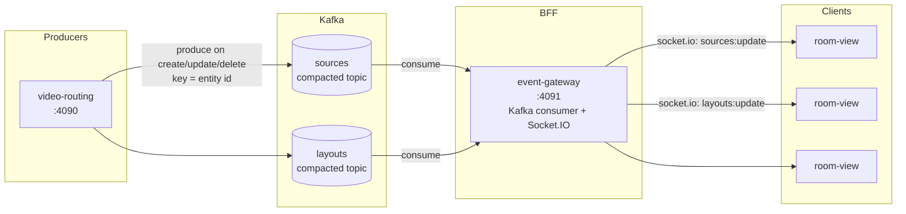
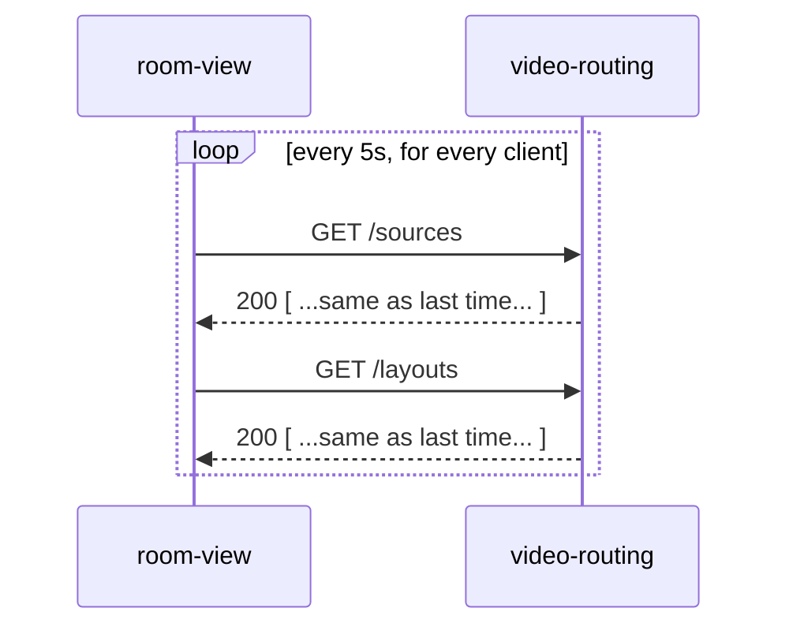
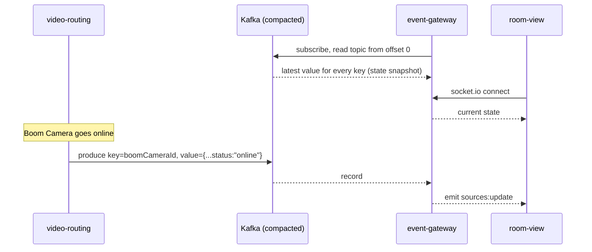

# Polling to Events

A demo that shows how a UI that **polls** backend services for state can be moved to one that is **told** when state changes. Changes are published to **Kafka compacted topics**, and a backend-for-frontend (**BFF**) consumes them and pushes them to the browser over **Socket.IO**.

The domain is a simple video-routing system for an operating room. It has **sources** (cameras such as "Surgical Field Camera" and "Boom Camera") and **layouts** (how those sources are arranged on a display). A room display needs to show the current state of both.

---

## Why move away from polling?

The `room-view` app currently polls `GET /sources` and `GET /layouts` every 5 seconds. Each response is logged and marked `changed` or `no change`. Running it for a minute makes the problem easy to see: almost every request comes back with `no change`.

| | Polling | Events |
|---|---|---|
| **Latency** | Up to one poll interval (5s here) before a change shows up | Close to real time: pushed as soon as it is published |
| **Wasted work** | Most requests return data the client already has | Traffic only happens when something changes |
| **Load on the source service** | Grows with *number of clients × poll frequency* | Grows with *rate of change*; clients never call the service directly |
| **Tuning** | Trade-off between freshness and load, with no good setting for both | No interval to tune |
| **Coupling** | Every client needs to know about, and be able to reach, every service it reads | Clients connect to one gateway; services only publish to a topic |
| **Change detection** | Client diffs whole payloads to work out what changed | Each event *is* the change |
| **Missed intermediate states** | A value that flips and flips back between polls is never seen | Every change is delivered |

Polling is still simple and sometimes the right call. This demo is about what you gain once there are many clients, many services, or a need for fresh data.

---

## Target architecture



### Before: polling



### After: events



---

## Why Kafka *compacted* topics?

A normal Kafka topic is a log of events that is deleted once it is older than the retention period. A **compacted** topic (`cleanup.policy=compact`) keeps **at least the latest record for each key**. That makes it a good fit for distributing *state*:

- **The topic is the current state.** Use the entity id as the record key (for example, the source id). Once compaction has run, the topic holds roughly one record per source: its latest value.
- **New consumers can bootstrap themselves.** When the BFF starts, or a new instance is added, it reads the topic from the beginning and ends up with the full current state. It doesn't have to call `video-routing` for a snapshot, and there is no race between the snapshot and the change stream.
- **Deletes are tombstones.** Producing a record with the key and a `null` value marks the entity as deleted. Compaction later removes the key altogether.
- **Storage is bounded by entity count, not by history.** A camera that changes status 10,000 times still compacts down to one record.
- **Ordering per entity.** Records with the same key go to the same partition, so consumers see changes to a given source in order.

This is the same "table as a stream" idea behind KTables and log-compacted changelogs. The trade-off is that compaction loses intermediate history. If you need a full audit trail, use a separate non-compacted topic.

Example topic config:

```bash
kafka-topics.sh --create \
  --topic video-routing.sources \
  --partitions 3 \
  --replication-factor 1 \
  --config cleanup.policy=compact \
  --config min.cleanable.dirty.ratio=0.1 \
  --config segment.ms=60000
```

(The low `segment.ms` and `min.cleanable.dirty.ratio` make compaction easy to observe in a demo. Production values would be much higher.)

---

## Why a BFF + Socket.IO?

Browsers can't (and shouldn't) talk to Kafka directly. The `event-gateway` service sits between the two:

- **One Kafka consumer, many browsers.** The gateway consumes each topic once and fans updates out to every connected socket. Kafka load doesn't grow with the number of clients.
- **Holds current state in memory.** Because it has read the compacted topic, it can send a newly connected client the full current state straight away, then stream deltas.
- **Shapes data for the UI.** It can filter, join or reshape events (for example, only send the sources used by a room's layout) without changing producers.
- **Socket.IO handles the transport.** Reconnection, heartbeats, fallback transports and rooms/namespaces (such as one room per operating room) come built in.
- **Security boundary.** Authentication and authorisation happen at the gateway, so Kafka stays internal.

---

## Repository layout

```
.
├── video-routing/   # Source-of-truth REST API for sources and layouts (Fastify, :4090)
├── event-gateway/   # BFF: Kafka consumer → Socket.IO broadcaster (Fastify + socket.io, :4091)
└── room-view/       # React UI that displays sources and layouts (Vite, :5173)
```

### `video-routing`

A Fastify + Zod service with in-memory repositories, seeded with two sources.

| Method | Path | Description |
|---|---|---|
| `GET` | `/sources` | List sources |
| `POST` | `/sources` | Create a source |
| `PATCH` | `/sources/:id` | Update a source (e.g. toggle `status`) |
| `DELETE` | `/sources/:id` | Delete a source |
| `GET` | `/layouts` | List layouts |
| `POST` | `/layouts` | Create a layout |
| `PATCH` | `/layouts/:id` | Update a layout |
| `DELETE` | `/layouts/:id` | Delete a layout |
| `GET` | `/system/liveness` · `/system/readiness` · `/system/version` | Health endpoints |

In the event-driven version, each create, update or delete also produces a record to the matching compacted topic. Deletes produce a tombstone.

### `event-gateway`

A Fastify service with a Socket.IO server attached to the same HTTP server. It is the BFF that will consume Kafka and emit events such as `sources:update` and `layouts:update` to connected clients.

### `room-view`

A React 19 + TanStack Query app.

- `usePolling` polls an endpoint every 5s and logs each response as `changed` or `no change`. This is the "before" picture.
- `useSourceEvents` connects to the gateway with `socket.io-client` and listens for `sources:update`. This is the "after" picture.

---

## Running the demo

Prerequisites: Node.js 22+ and pnpm. Kafka is also needed for the event-driven flow; see below.

In three terminals:

```bash
# 1. Source-of-truth API
cd video-routing && pnpm install && pnpm dev     # http://localhost:4090

# 2. BFF / socket gateway
cd event-gateway && pnpm install && pnpm dev     # http://localhost:4091

# 3. UI
cd room-view && pnpm install && pnpm dev         # http://localhost:5173
```

### Demo script

1. **Show polling.** Open `http://localhost:5173` and watch the `/sources` and `/layouts` logs fill with `no change` every 5 seconds.
2. **Make a change.**
   ```bash
   SOURCE_ID=$(curl -s localhost:4090/sources | jq -r '.[] | select(.name=="Boom Camera") | .id')
   curl -X PATCH localhost:4090/sources/$SOURCE_ID \
     -H 'content-type: application/json' \
     -d '{"status":"online"}'
   ```
   Point out the delay before the UI notices, and how many wasted requests came before it.
3. **Switch to events.** With the event flow running, repeat the change. The UI updates almost straight away, and there are no requests in between.
4. **Show compaction.** Toggle the same source many times, then consume the topic from the beginning:
   ```bash
   kafka-console-consumer.sh --bootstrap-server localhost:9092 \
     --topic video-routing.sources --from-beginning \
     --property print.key=true
   ```
   Once compaction has run, only the latest value per key remains.
5. **Show bootstrapping.** Restart `event-gateway`. It rebuilds its state from the compacted topic, without calling `video-routing`.

### Running Kafka locally

Single-node KRaft broker (no ZooKeeper):

```bash
docker run -d --name kafka -p 9092:9092 apache/kafka:latest
```

---

## Status

This repo is being built up step by step for the demo:

- [x] `video-routing` REST API for sources and layouts
- [x] `room-view` polling hook and log view
- [x] `event-gateway` service with Socket.IO bootstrapped
- [ ] `room-view` socket hook wired into the UI
- [ ] `video-routing` produces to Kafka compacted topics
- [ ] `event-gateway` consumes Kafka and broadcasts over Socket.IO
- [ ] Docker Compose for Kafka + all services

## Tooling

- **Runtime:** Node.js, TypeScript, `tsx` for dev
- **HTTP:** Fastify 5, Zod 4 for validation
- **Realtime:** Socket.IO 4
- **Frontend:** React 19, Vite, TanStack Query
- **Lint/format:** Biome (and oxlint in `room-view`)
